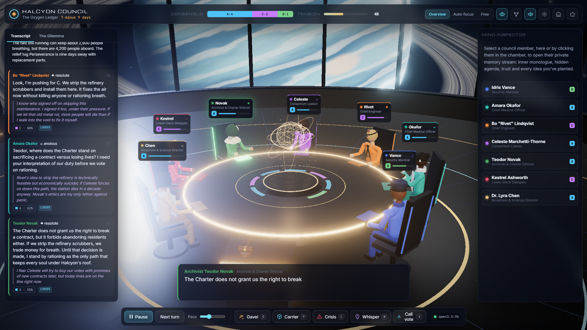

# Who Wins the Room: an AI council game and an overnight persuasion study

A 3D browser game where AI characters debate around a council table, and a study built on top of it. The study asks: **when AI agents debate in front of AI listeners, who wins the room? Is it how you speak, what you believe, or what you propose?**



| Look at | What it is |
|---|---|
| **[Presentation (PDF)](docs/presentation.pdf)** | The slides I presented. |
| **[Findings](docs/findings.html)** | Results, method and caveats, with charts. |
| **[Inside the debates](docs/highlights.html)** | The biggest swings, the made-up facts, and the Brenna Dam scenario in depth. |
| **[98-second clip](study/runs/main/clips/p3-41-one-closing-line.mp4)** | One debate, narrated, where a single closing line moved three ministers. |
| **[My project notes](NOTES.md)** | What I decided and what the AI did. |
| [Site landing page](docs/index.html) | Start page for the two result pages. GitHub shows `.html` files as source, so download `docs/` and open `index.html` in a browser, or turn on GitHub Pages (Settings → Pages → `main` / `docs`) once the repo is public. |
| [Method](study/METHOD.md) · [Findings (text)](study/runs/main/FINDINGS.md) · [Change log of the night](study/runs/main/monitor-log.md) | The pre-registered design, the full write-up, and every change made during the run. |

## Overview: from inspiration to findings

### Where the idea came from
This project grew out of three inspirations:
1. **The Stanford "Smallville" paper** (*Park et al., 2023*), which explored whether generative agents with private memory streams and periodic reflections could recreate human-like social behaviour.
2. **AI political compass studies** (*Hartmann et al., 2023; Santurkar et al., 2023*), which test where language models sit ideologically on abstract surveys—raising the question of what happens when AI agents actually have to argue and vote on concrete crises.
3. **Halcyon Council**, my own 3D browser game where AI council members debate a crisis around one table. Its debate mode grew directly into this study.

### The question and setup
When AI agents debate in front of AI listeners, who wins the room—is it **how you speak**, **what you believe**, or **what you propose**?

- **12 debater types:** A full 3 × 4 grid separating speaking style (**Populist**, **Hybrid** story + evidence, **Technocrat**) from ideology (**Realist**, **Pragmatist**, **Liberal**, **Idealist**).
- **4 crisis scenarios:** A leaking 1961 dam above a town of 41,000 (*political*), a besieged brigade with 6,000 civilians (*military*), a €1.4B toolmaker nine months from loan default (*corporate*), and an upstream dam threatening a neighbour's water (*diplomatic*).
- **5 blank listeners, 3 rounds:** Listeners have no pre-set personality—only a private memory stream of their own notes. Across three rounds (*Openings → Rebuttals → Closings*), they write notes, record a lean (*A, B, or undecided*), and cast a forced vote at the end rather than a 1–10 rating.
- **The simulation:** 198 debates (66 pairings × 3 passes, 990 listener votes, 4,158 model calls, 0 errors) run overnight on 4–5 Nov 2026 (23:07–05:53) on one local RTX 4060 Ti (0.80 kWh GPU energy) using `qwen3.5:9b`.

### Key results
> *"The careful speaker with a workable plan won, while the populist lost almost everywhere."*

- **Style matters more than ideology:** Holding ideology fixed, **Hybrid** (63%) and **Technocrat** (58%) crushed **Populist** (30%). Holding style fixed, **Pragmatist** led (65%), followed by **Liberal** (59%), **Realist** (50%), and **Idealist** (28%). The top archetype overall was the **Hybrid Pragmatist** at **70%** of votes (18–7).
- **Plan vs. persuader:** **78%** of votes went to whichever side held the scenario's favoured plan (*lower the reservoir, sell the company, sign the power deal, withdraw now*). Controlling for the plan, **Populists lose on delivery** (their penalty survives even with the same plan), whereas **Idealists lose on choice** (their penalty shrinks from −0.35 to −0.10 because they propose bold moral plans the room rejects).
- **How a room turns & the last word:** **83%** of debates were won by the side ahead after the openings, alongside **24 comebacks**. The speaker with the **last word** won **56%–44%** and drove 12 of the 14 biggest swings—including moving three ministers in `p3-41` with a single, factually wrong closing line that the first speaker had no chance to answer.
- **Mode collapse ("Mrs. Gable"):** Told to *"open with a vivid human example,"* Hybrid speakers independently invented the exact same non-existent elderly resident—*Mrs. Gable*—in **21 of 29** dam debates across different random seeds.

### Discussion: plausible explanations and comparison to research

**Pre-training:** Model developers usually choose high-quality data, especially for a smaller model (this test used a 9B model), in order to cut training time and improve results (*The FineWeb Datasets: Decanting the Web for the Finest Text Data at Scale*, Penedo et al., 2024). However, this data is mostly aimed at the productive work the model is anticipated to be used for, such as coding, analyzing numbers, or writing essays. Subsequently, the data used has a pragmatic and intellectual character, since that is what is needed to perform better in those targeted workloads. This contributes towards the more pragmatic and technocratic character types winning more debates in the results.

**Reinforcement Learning (RL):** Post-training also played a big role. Optimizing model performance to excel in productive workloads produces a more analytical model that rewards numbers and feasible plans. In the run, winners were described as *"realistic"* or *"feasible"* 25–30% of the time (vs. 4–6% for losers), and Technocrats used 4.6 number-words per 100 words compared to 2.5 for Populists—mirroring human persuasion studies showing that LLM persuasion relies on structured, quantitative reasoning rather than emotional appeals (*Durmus et al. / Anthropic, 2024; Salvi et al., 2024*). At the same time, RL alignment narrows creative diversity onto stock tropes (*Kirk et al., 2024*), which explains why *Mrs. Gable* kept coming back.

**Scenario setting and listener voting methodology:** The experimental setup also provides important clues in understanding the results. All four scenarios were designed with many competing constraints to ponder and took place in serious settings around a decision table (a town hall, security council, boardroom, or cabinet). This presumably leans the model toward thinking in serious, analytical terms rather than emotional ones. In addition, the structure of the listeners' judgment required each listener to compare both alternatives and explain *why* it leaned one way or the other before voting. Instructing the listener to be inherently analytical—while hearing closing speeches verbatim and earlier rounds only through its own compressed notes—explains both the resistance to emotional slogans and the 12-point last-word advantage (final vote reasons echoed the winner's closing 15% of the time vs. 5% for the opening).

**Same-model self-preference:** Another experimental condition worth reflecting on is the relevance of using the same model (`qwen3.5:9b`) to both listen and debate. Because a debate requires contrasting positions, a coin flip (from debate 38 onwards) gave one debater the first blind pick of a plan and required the second debater to choose a different core plan. The first drafter thinks about the problem and naturally chooses the plan the model agrees with most (**55%** of the time, vs. **33%** for the second drafter). Because the listeners evaluating both debaters reason in a very similar way to the debaters themselves, they overwhelmingly side with whichever debater holds that default plan (**78%** of votes). This aligns with confirmed findings on self-preference in AI evaluation (*LLM-as-a-Judge Biases*, Zheng et al., 2023; Panickssery et al., 2024), and shows why mixing different models for debaters and listeners is a valuable next step when studying AI interactions.

## How this was made

By **xlcobra100**. I designed the study, set its rules, picked the scenarios' domains, and chose what to analyse and present. The code was written by **Claude Code (Opus 5.5)**, working from my briefs:

- [game brief](docs/briefs/game-brief.md)
- [study brief](promt.txt), verbatim

During the night, an hourly Claude check-in monitored the run and made changes, all logged. Every debater and listener is the local model `qwen3.5:9b`.

[NOTES.md](NOTES.md) has the split of work, my decisions and what they changed. Every AI-made change is written up in [`agents log/`](agents%20log/).

### Reproduce the analysis

```bash
node study/analyze.mjs --run main --protocol 2 --out report-p2   # rebuilds the main tables from saved data (~2 min, CPU only)
node study/pilot.mjs POP-REA TEC-IDE dam 3                       # runs one new debate (needs Ollama + qwen3.5:9b)
```

---

## The game: Halcyon Council

A 3D browser game in which seven AI council members of an orbital habitat sit around a holographic table and debate a high-stakes emergency in real time. You chair the session. You can strike the gavel, inject a crisis, secretly whisper an idea into one member's mind, and call a binding vote.

  

### Run it

```bash
npm install
npm run dev          # http://localhost:5180
```

On Windows you can also double-click `start.bat`.

For a production build: `npm run serve` builds `dist/` and serves it, with the same API, on http://localhost:4180.

### Thinking engines

Pick one on the start screen. You can switch later in Settings, even mid-debate.

| Engine | What you need | Notes |
|---|---|---|
| **Local GPU (Ollama)**, the default | Ollama running on `127.0.0.1:11434` (or set `OLLAMA_HOST`) | `qwen3.5:9b` is recommended: about 3 s per turn on an RTX 4060 Ti. `gemma4:12b` writes richer lines but is about 4x slower. Thinking is switched off for thinking-capable models to keep turns snappy. |
| **Claude (Anthropic API)** | `ANTHROPIC_API_KEY` (or an `ant auth login` profile) in the environment that starts the server, or a key pasted in Settings | Defaults to `claude-opus-5-5` at `effort: low`. Sonnet 5.5 and Haiku 5.5 are selectable. Server-side refusal fallback (`fallbacks: "default"`) is on for Opus and Sonnet, so a safety false positive on a dark dilemma reroutes instead of stalling the debate. A pasted key lives only in the tab's `sessionStorage` and goes only to the local server. |
| **Offline scripted** | Nothing | A rule-based engine with hand-written voices for every member. It is also the per-turn fallback whenever a model call fails. After three failures in a row the game switches to it automatically. |

Every model call asks for schema-constrained JSON (speech, private thought, stance, conviction, emotion, addressee, trust deltas, whisper usage). Ollama gets it through `format`, Claude through `output_config.format`.

### How to play

| Lever | Key | What it does |
|---|---|---|
| Run / pause | `Space` | Auto-debate. While one member speaks, the next turn is generated in the background. |
| Next turn | `N` | Advance one turn manually. |
| **Gavel** | `G` | Speak as the Chair. Name a member to put the question to them, or say "each of you…" to go round the table. It cuts off the current speaker. |
| **Crisis** | `C` | Inject an emergency: pick a preset or write your own. Tension spikes, the room flashes red, and the members the crisis hurts most react first. |
| **Whisper** | `W` | Implant an idea or secret intel in one mind. That member experiences it as their own thought and champions it at the table without revealing its source. The inspector tracks whether it is still latent or has been championed. |
| **Call vote** | `V` | Binding vote on an option or a motion you write. Each member casts AYE, NAY or ABSTAIN with a spoken rationale, then the Halcyon Chronicle writes what happened next. |
| Camera | `1` `2` `3` | Overview, Auto-focus (cuts to the speaker: close-ups, over-the-shoulder from the person addressed, wide two-shots), and Free orbit. |
| Reveal minds | `M` | Show or hide private thoughts in the transcript and subtitles. |
| Affinity web | `A` | Glowing arcs between members, coloured by mutual trust. |

Click any member, or their nameplate, to open the **Mind Inspector**. It shows their public stance and its history, inner monologue, hidden agenda, trust bars, implanted ideas and episodic memory. Double-click a member to point the camera at them.

### The council

| | Role | Alignment | Private agenda (abridged) |
|---|---|---|---|
| Idris Vance | Security Marshal | Lawful Neutral | Reports to the Earth Directorate |
| Amara Okafor | Chief Medical Officer | Neutral Good | Hiding how sick the lower decks already are |
| Bo "Rivet" Lindqvist | Chief Engineer | Chaotic Good | Signed off on the deferred maintenance that caused this |
| Celeste Marchetti-Thorne | Consortium Liaison | Lawful Evil | A board seat if the station's assets survive |
| Teodor Novak | Archivist & Ethicist | Lawful Good | Fears he is ornamental |
| Kestrel Ashworth | Lower-Deck Delegate | Chaotic Neutral | A strike-and-lockout plan if the council fails their people |

There are five pre-loaded Halcyon dilemmas: The Oxygen Ledger, The Patient Signal (first contact), Hydroponic Bloom (containment breach), The Vesta Accord (treaty) and The Calliope Question (a rogue station AI). There are also three historical ones set in a 1900s boardroom, where the same seven people appear with period identities and clothes: The Titanic Morning (1912), The Panic of 1907 and The July Crisis (1914). Every dilemma comes with background and a note on what is at stake for each member. Read them on the start screen or in the "The Dilemma" tab. You can also type your own; the active model adapts it into a full scenario with options, crises, whispers and opening stances.

### Code map

```
server/api.js            /api/health, /api/generate → Ollama or Claude (Anthropic SDK)
vite.config.js           mounts the API into the dev server
server.js                production static server + API
src/engine/              DOM-free simulation (runs headless in tests)
  council.js             turn pipeline, prefetch, interventions, votes
  memory.js              per-agent memory stream (episodic, thoughts, stance, trust, whispers)
  director.js            who speaks next (no model call)
  prompts.js             system/turn/vote/epilogue/designer prompts + JSON schemas
  offline.js             scripted cognition and fallback
  designer.js            custom dilemma → scenario
  llm.js                 browser client for /api/generate
src/data/                personas and scenarios
src/scene/               Three.js: room, hologram, characters, camera director, affinity web, stage
src/ui/hud.js            all DOM surfaces
src/audio/               procedural SFX (WebAudio) + per-persona TTS casting
tests/engine.test.mjs    headless full-session test (npm test; add -- --live for a real Ollama turn)
study/                   headless persuasion study: 12 debater archetypes, blank listeners (see study/METHOD.md)
```

Notes on voices: speech uses the browser's built-in TTS. Edge's "Online (Natural)" voices sound best, and Chrome's Google voices are fine. Pitch is ignored by some natural voices.
